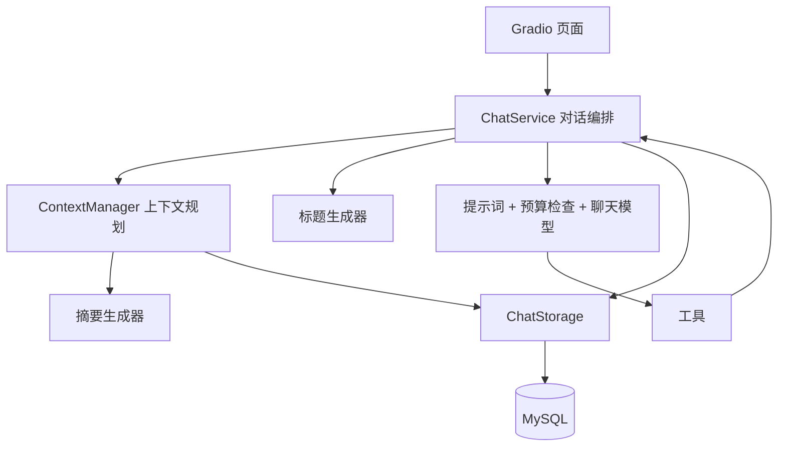

# AI Agent 学习助手

一个使用 **Gradio、LangChain 和 MySQL** 构建的文本对话应用。项目通过兼容 OpenAI 协议的模型接口提供流式回答，支持工具调用、多会话管理、历史持久化、上下文摘要和 Token 预算检查。

默认系统提示词将助手设定为 AI Agent 开发导师，帮助用户学习 Python、LangChain、LangGraph、LLM API、Prompt、Tools、Memory 和 RAG。这些是助手的教学主题；当前应用的实际执行流程由 Python 服务代码编排，没有使用 LangGraph，也没有实现 RAG 检索。

## 目录

- [主要功能](#主要功能)
- [架构与目录](#架构与目录)
- [安装与运行](#安装与运行)
- [使用方式](#使用方式)
- [配置说明](#配置说明)
- [一次对话如何执行](#一次对话如何执行)
- [历史与上下文管理](#历史与上下文管理)
- [数据库设计与可靠性](#数据库设计与可靠性)
- [测试](#测试)
- [异常轮次恢复](#异常轮次恢复)
- [常见问题](#常见问题)
- [扩展与当前边界](#扩展与当前边界)

## 主要功能

| 功能 | 当前行为 |
| --- | --- |
| 流式对话 | 逐段显示模型回答，支持停止生成 |
| 等待提示 | 发送后显示临时“思考中…”，首段文字到达后替换；停止或失败时清除 |
| 会话列表 | 侧边栏每行一个标题，最多显示最近活跃的 20 个会话；内部使用完整 UUID 区分同名会话 |
| 分阶段加载 | 先显示会话标题，再读取选中会话的最近消息；其他会话按需读取 |
| 历史分页 | 默认加载最近 20 个已完成轮次，点击“加载更早消息”继续向前读取 |
| 自动标题 | 根据新会话首条输入生成最多 30 个字符的标题；失败时使用输入摘录 |
| 工具调用 | 内置城市天气查询，保存模型工具请求和工具结果 |
| 持久化 | 会话、轮次、消息和摘要分别保存到 MySQL |
| 上下文管理 | 将旧摘要与未覆盖的完整轮次组合，预算不足时更新摘要 |
| 输入预算 | 使用本地 tokenizer 估算消息及工具定义的 Token 开销 |
| 故障处理 | 区分完成、失败、中断轮次；保存已收到的部分模型输出，支持人工修复遗留轮次 |
| 连接复用 | MySQL 连接池首次建立 1 条连接，按需扩展，最多 5 条 |

“思考中…”只是界面等待状态，不表示展示模型内部推理，也不会保存到数据库或发送给模型。

## 架构与目录



```text
.
├── chatbot_v2_stream.py       # 应用入口，组装依赖并启动 Gradio
├── app_config.py              # 环境变量、模型及上下文预算配置
├── agent_factory.py           # 系统提示词、模型链、工具绑定
├── agent_tools.py             # 天气查询工具
├── chat_ui.py                 # 会话列表、分页、流式展示和等待状态
├── chat_service.py            # 轮次编排、消息保存、标题更新、存储重试
├── chat_storage.py            # MySQL 查询、事务、连接池和幂等写入
├── context_manager.py         # 摘要边界、近期轮次和上下文准备
├── context_adapter.py         # 将上下文转换成提示词变量
├── summary_generator.py       # 分批生成并校验历史摘要
├── session_title_generator.py # 生成、清洗和截断会话标题
├── token_budget_checker.py    # 本地 Token 估算与超限检查
├── history_loader.py          # 从数据库记录恢复完整轮次
├── history_validation.py      # 校验消息顺序和工具调用闭环
├── history_display.py         # 将有效历史转换成聊天气泡
├── message_converter.py       # LangChain 消息与数据库载荷转换
├── recover_turn.py            # 检查、修复遗留 running 轮次
├── model_assets/
│   ├── tokenizer.json         # 主程序实际使用的本地分词器
│   ├── tokenizer_config.json
│   └── deepseek_tokenizer.py  # 辅助示例，主程序不依赖它
├── mysql/
│   ├── init.sql              # 建库建表模板（占位符 ${MYSQL_DATABASE}）
│   ├── create_app_user.sql   # 创建应用账户并授权的模板
│   └── apply_sql.py          # 读取 .env 渲染并执行上述脚本

```


## 安装与运行

### 1. 准备环境

- Python：当前开发环境为 **3.13.5**。
- MySQL：使用 MySQL 8.x；建表脚本包含 JSON、外键、CHECK 约束及 `utf8mb4_0900_bin` 排序规则。
- 模型服务：需要支持聊天流式输出及工具调用的 OpenAI 协议兼容接口。
- 天气工具需要能访问 Open-Meteo 的地理编码及天气接口。

下面使用 Windows PowerShell，所有命令均在项目根目录执行。通过虚拟环境中的 Python 路径运行，无需修改 PowerShell 脚本执行策略。

```powershell
python -m venv .venv
.\.venv\Scripts\python.exe -m pip install --upgrade pip
.\.venv\Scripts\python.exe -m pip install "gradio==6.26.0" "langchain==1.3.18" "langchain-core==1.6.1" "langchain-community==0.4.2" "langchain-openai==1.6.0" "mysql-connector-python==26.7.0" "python-dotenv==1.1.0" "requests==2.34.2" "tokenizers==0.23.3"
```

### 2. 初始化数据库

数据库名、地址和账户配置统一放在项目根目录的 `.env`。`mysql/init.sql` 与 `mysql/create_app_user.sql` 只使用 `${MYSQL_*}` 占位符，不写死数据库名和地址；`mysql/apply_sql.py` 读取 `.env` 后渲染并执行，连接时需要一个具备 `CREATE DATABASE`、`CREATE USER`、`GRANT` 权限的管理员账户（默认 `root`）。

在项目根目录执行：

```powershell
.\.venv\Scripts\python.exe mysql\apply_sql.py              # 建库建表，再创建应用账户并授权
.\.venv\Scripts\python.exe mysql\apply_sql.py init         # 只建库建表
.\.venv\Scripts\python.exe mysql\apply_sql.py app_user     # 只创建应用账户并授权
.\.venv\Scripts\python.exe mysql\apply_sql.py --dry-run    # 只打印渲染后的 SQL，不连接数据库
```

管理员账户由 `MYSQL_ADMIN_USER` 指定（默认 `root`），密码取 `MYSQL_ADMIN_PASSWORD`；未设置时在执行时交互输入，所以不必写进 `.env`。也可以先运行 `--dry-run`，把渲染后的 SQL 复制到 MySQL 客户端手工执行。

应用账户需要的权限：

| 表 | 权限 |
| --- | --- |
| `sessions`、`turns`、`messages` | `SELECT`、`INSERT`、`UPDATE` |
| `summaries` | `SELECT`、`INSERT` |

`CREATE TABLE IF NOT EXISTS` 不会把已有表自动迁移到新结构。已有数据库应先核对结构；`CREATE USER IF NOT EXISTS` 也不会重设已存在账户的密码，修改 `MYSQL_PASSWORD` 后需要手工执行 `ALTER USER` 才会生效。

### 3. 配置环境变量

在项目根目录新建 `.env`：

```dotenv
DEEPSEEK_API_KEY=replace_with_your_api_key
base_url=https://your-provider.example/v1

MYSQL_HOST=127.0.0.1
MYSQL_PORT=3306
MYSQL_DATABASE=chat_memory
MYSQL_USER=chat_app
MYSQL_PASSWORD=replace_with_your_database_password

# 应用账户允许连接的来源地址，留空或删除时取 MYSQL_HOST
MYSQL_APP_HOST=127.0.0.1
# 执行 mysql/apply_sql.py 的管理员账户
MYSQL_ADMIN_USER=root
# 可选：管理员密码，不配置时运行脚本会提示输入
# MYSQL_ADMIN_PASSWORD=
```

示例域名不可直接使用，必须替换成实际服务地址。变量名 **`base_url` 是小写**，与代码一致。虽然它在读取时没有被强制校验，连接自定义模型服务时仍应明确配置；不要依赖 SDK 的默认地址。

默认模型名在 `app_config.py` 中写为 `deepseek-flash`。这是项目配置值，必须确认你的服务端支持这个模型标识；如不支持，修改该文件中的 `model_config["model"]`。密钥变量名固定为 `DEEPSEEK_API_KEY`，不会因为换模型而自动变化。

`.env` 已被 Git 忽略。现有进程环境变量默认优先于 `.env` 中的同名值。

### 4. 检查 tokenizer 文件

确认 `model_assets/tokenizer.json` 存在。聊天和摘要预算检查器都会从项目路径加载它，启动时不会自动下载分词器。

### 5. 启动应用

```powershell
.\.venv\Scripts\python.exe chatbot_v2_stream.py
```

打开终端打印的本地地址。当前入口使用：

```python
page.queue().launch(share=True, css=CHAT_CSS)
```

`share=True` 会尝试创建外部分享链接。本地使用时可以在入口文件中改成 `share=False`。当前没有登录认证，页面统一使用 `user_001`，分享链接也不会自动提供用户隔离。

修改 Python 代码后，停止当前进程并重新启动应用。

## 使用方式

1. 打开页面后，先显示最近活跃的 20 个会话标题，随后加载默认选中会话的最近 20 个已完成轮次。
2. 点击侧边栏标题切换会话；每个会话占一行，较长标题以省略号显示。
3. 点击“＋ 新建会话”创建空会话；首条输入保存后生成标题。
4. 输入消息，按回车或点击“发送”。页面立即显示用户消息并清空输入框，随后显示“思考中…”。
5. 首段可见回复到达时，等待提示在原位置被替换为回答，后续内容继续流式更新。
6. 点击“停止生成”取消当前生成；已有可见回答保留，临时等待提示清除。
7. 有更早历史时，点击“加载更早消息”向前追加一页。

**20 个会话与 20 个轮次是两个独立限制。**一个轮次包含一次用户输入及其后续助手消息、工具请求和工具结果，可能对应多条数据库消息。分页以完整轮次为单位，不会把工具调用链拆成两页。

侧边栏目前没有加载更早会话的按钮，超过最近 20 个的会话仍保存在数据库中。页面也不展示内部会话 UUID。

## 配置说明

| 配置 | 当前值 | 修改位置 |
| --- | --- | --- |
| 聊天模型名称 | `deepseek-flash` | `app_config.py` |
| 聊天温度 | `0.7` | `app_config.py` |
| 聊天上下文窗口预算 | `128000` | `load_context_settings()` |
| 聊天输出预留 | `16000` | `load_context_settings()` |
| 聊天安全余量 | `4000` | `load_context_settings()` |
| 聊天输入预算 | `108000`，由前三项计算 | `TokenBudgetChecker` |
| 摘要窗口 / 输出预留 / 安全余量 | `16000 / 4096 / 1000` | `chatbot_v2_stream.py` |
| 摘要输入预算 | `10904` | 由摘要预算计算 |
| 摘要正文上限 | `2048` tokens | `chatbot_v2_stream.py` |
| 摘要策略版本 | `learning_v1` | `chatbot_v2_stream.py` |
| 摘要时保留的近期轮次 | `2` | `ChatService(keep_recent_turns=2)` |
| 标题长度 / 输入截取 | `30 / 2000` 个字符 | `session_title_generator.py` |
| 标题模型温度 / 超时 / SDK 重试 | `0 / 10秒 / 0次` | `chatbot_v2_stream.py` |
| 标题模型输出上限 | `128` tokens | `chatbot_v2_stream.py` |
| 侧边栏会话数量 | `20` | `chat_ui.py` 的 `SESSION_LIST_LIMIT` |
| 历史每页轮次数 | `20` | `ChatStorage.load_message_page()` |
| 数据库连接超时 | `5秒` | `ChatStorage.__init__()` |
| 数据库连接池容量 | 最多 `5`，首次建立 `1` | `ChatStorage._connect()` |
| 页面用户标识 | `user_001` | `chatbot_v2_stream.py` |

预算数字是应用配置，**不是模型官方容量声明**。切换服务或模型时，应同时核对 tokenizer、上下文容量、输出上限及服务端对 `extra_body.max_tokens` 的支持。

## 一次对话如何执行

1. `chat_ui.py` 显示用户输入和临时等待提示。已有页面消息只用于展示，不直接作为模型的可信历史。
2. `ChatService` 创建 `running` 轮次，记录本轮执行配置，然后保存用户消息。
3. 如果是第一轮且标题仍为占位标题，调用独立标题模型并保存结果。此步骤目前同步执行，会增加首次回复前的等待。
4. `ContextManager` 读取最新摘要、轮次状态和需要恢复的历史，生成模型输入。
5. `TokenBudgetChecker` 检查请求预算，聊天模型开始流式输出。
6. 如果模型请求工具，完整保存助手工具请求，执行工具并保存 `ToolMessage`，然后继续请求模型。
7. 收到有效最终回答后，保存助手消息，将轮次标记为 `completed`。
8. 页面根据已保存的标题结果静默更新侧边栏，不重新查询整个列表。

模型响应的 `finish_reason` 需要为 `stop` 或 `tool_calls`，同时校验是否存在无效工具调用、空回答或不一致的结束状态。

## 历史与上下文管理

### 页面历史

- 首次加载先返回标题和选中状态，再查询选中会话的消息。
- 只按需读取最近一页，其他会话不做整批消息预加载。
- 新会话已知为空，创建后不再查询空历史。
- 发送消息时复用页面已有内容，不为展示再次读取完整历史。
- 历史恢复只接纳已完成、消息完整且通过结构校验的轮次；工具结果不直接显示为聊天气泡。

### 模型上下文

模型输入由系统提示词、历史摘要、未被摘要覆盖的完整轮次、当前用户输入和本轮工具消息组成。

已有摘要时，只恢复摘要边界轮次及之后的原文。边界轮次用于验证摘要边界有效，不会重复放入摘要之后的对话历史。轮次状态仍会单独查询，以检查未结束轮次与摘要覆盖范围是否冲突。

当上下文仍在预算内时，直接使用旧摘要与未覆盖原文；**并非每发送一条消息就生成摘要，也不是始终只给模型最近两轮**。需要压缩时，将可摘要的旧轮次合并到摘要中，保留近期轮次；摘要边界不得越过尚未结束的轮次。

摘要生成器按完整轮次分批处理，使用独立预算。生成或保存失败时保留旧摘要和未覆盖原文；如果仍超出输入预算，则向页面返回错误，不静默丢弃历史。

同一轮工具循环会复用已准备的上下文，但重新检查预算；工具结果导致超限时，仍会重新准备上下文。该缓存只在本轮调用中使用。

### Token 统计的含义

本地检查器对消息和工具定义的 JSON 表示进行分词。结果是估算，不保证与服务端计费 Token 数一致。模型返回 usage 时，消息载荷同时记录估算输入、实际输入、实际输出及其差值，便于比较。

## 数据库设计与可靠性

| 表 | 主要内容 | 关键关联 |
| --- | --- | --- |
| `sessions` | 用户标识、标题、创建时间、更新时间、元数据 | `session_id` 主键 |
| `turns` | 轮次顺序、状态、执行配置、开始和结束时间、错误信息 | 所属 session；`(session_id, turn_seq)` 唯一 |
| `messages` | 消息顺序、角色、JSON 载荷、格式版本、完整性状态 | 所属 turn；`(turn_id, message_seq)` 唯一 |
| `summaries` | 摘要正文、覆盖轮次边界、策略版本 | 边界关联同一会话的轮次 |

轮次状态：

```text
running → completed
        → failed
        → interrupted
```

消息状态为 `completed` 或 `partial`。消息载荷保留 LangChain 原始序列化结果、工具关联信息，以及可用时的 Token 用量。已有部分流式输出发生异常或生成器关闭时，会尝试保存部分输出。

写入通过事务和行锁分配轮次、消息序号。创建轮次及保存消息时固定 UUID，结束轮次时校验已有结果，使可重试的同一请求不会重复创建记录。针对连接中断、死锁和锁等待超时等指定 MySQL 错误，服务层最多尝试 3 次，重试间隔为 0.2 秒和 0.4 秒；并非所有数据库操作或模型请求都使用此重试策略。

连接使用完毕会归还连接池并重置会话状态。数据库连接配置和初始化脚本均使用 UTC；前端当前不展示数据库时间字段。

## 异常轮次恢复

程序被强制关闭时，轮次可能遗留在 `running`。恢复脚本不会继续生成回答，只能检查并将指定轮次标记为 `interrupted`，保留原始消息。

查看某会话的未结束轮次：

```powershell
.\.venv\Scripts\python.exe recover_turn.py --session-id "替换为会话UUID"
```

预览目标轮次：

```powershell
.\.venv\Scripts\python.exe recover_turn.py --session-id "替换为会话UUID" --turn-id "替换为轮次UUID"
```

确认执行该轮次的所有程序已经停止后，再执行修改：

```powershell
.\.venv\Scripts\python.exe recover_turn.py --session-id "替换为会话UUID" --turn-id "替换为轮次UUID" --apply
```

页面不显示 UUID，可在数据库中定位：

```sql
SELECT session_id, title, updated_at
FROM sessions
WHERE user_id = 'user_001'
ORDER BY updated_at DESC, session_id DESC
LIMIT 20;
```

恢复脚本复用 `load_settings()`，因此当前即便只检查数据库，也要求配置 `DEEPSEEK_API_KEY`。

## 常见问题

| 现象 | 检查方向 |
| --- | --- |
| 提示缺少 API Key | 检查项目根目录 `.env` 及 `DEEPSEEK_API_KEY`，确认使用了正确的 Python 环境 |
| 模型不存在、鉴权失败或接口不兼容 | 核对小写 `base_url`、模型名、密钥及工具调用支持；项目默认模型名不一定是你的服务端模型名 |
| 找不到 tokenizer 文件 | 确认 `model_assets/tokenizer.json` 存在且为有效 tokenizer JSON |
| MySQL 连接失败或拒绝访问 | 检查服务、端口、密码和授权；应用账户允许的来源地址由 `MYSQL_APP_HOST` 控制，默认等于 `MYSQL_HOST` |
| 表不存在或字段不匹配 | 确认 `.env` 指向已初始化的数据库，已有表需要单独核对结构 |
| 首条回复较慢 | 首次连接、同步生成标题、上下文处理及模型首段响应都发生在等待阶段 |
| 标题很快出现，消息仍在加载 | 属于分阶段加载；此时查询的是选中会话的最近一页，而非所有会话消息 |
| 侧边栏没有旧会话 | 当前最多显示最近活跃的 20 个，数据没有因此删除 |
| 输入预算不足 | 缩短输入、缩小工具结果，或按实际模型能力调整预算；当前输入本身过大时不能靠摘要解决 |
| 数据库有消息，页面恢复时没有显示 | 检查轮次是否已完成、消息是否为 partial，以及消息序列和工具调用是否通过校验 |
| 停止后重新打开会话，部分回答消失 | 中断轮次不作为有效历史恢复；原始及部分消息可能仍保留在数据库中 |
| 天气查询失败 | 检查外部网络及城市名称；工具使用两次 HTTP 请求，各设置 10 秒超时 |
| 切换会话仍需等待 | 当前新建、切换、发送和分页共享单并发队列，以避免旧回复更新到新会话页面 |

实际性能应分别测量数据库连接、SQL 查询、消息恢复、模型首段响应和 Gradio 排队时间。当前测试验证调用行为，没有对真实数据库和模型做性能基准测试。

## 扩展与当前边界

### 常见扩展位置

- 修改助手定位：编辑 `agent_factory.py` 中的 `SYSTEM_PROMPT`，并维护 `CHAT_PROMPT_VERSION`。
- 添加工具：在 `agent_tools.py` 定义工具，在 `build_agent()` 的工具列表注册；服务按名称调用它们。
- 更换模型：调整 `app_config.py`，同步检查接口格式、输出上限和本地 tokenizer。
- 调整摘要关注点：修改入口中的 `focus`；策略语义变化时更新 `summary_strategy_version`，区分旧策略摘要。
- 调整界面：编辑 `chat_ui.py`；自定义样式通过入口 `launch(css=CHAT_CSS)` 注入。

### 尚未实现的能力

- 用户登录、鉴权和多用户访问隔离；数据库中的 `user_id` 本身不构成访问控制。
- 侧边栏更早会话分页、会话搜索、手动重命名、删除及导出。
- 图片、音频等多模态输入，知识库检索及文件上传。
- 自动修复遗留轮次、断点续写和后台生成标题。
- 数据库自动迁移、完整依赖锁定、真实服务集成测试和浏览器端测试。

当前适合作为本地学习与功能迭代项目。若扩展成多人服务，需要进一步设计身份认证、数据访问校验、并发策略和部署配置。
